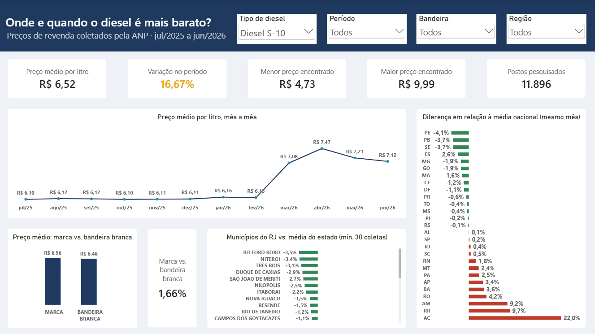
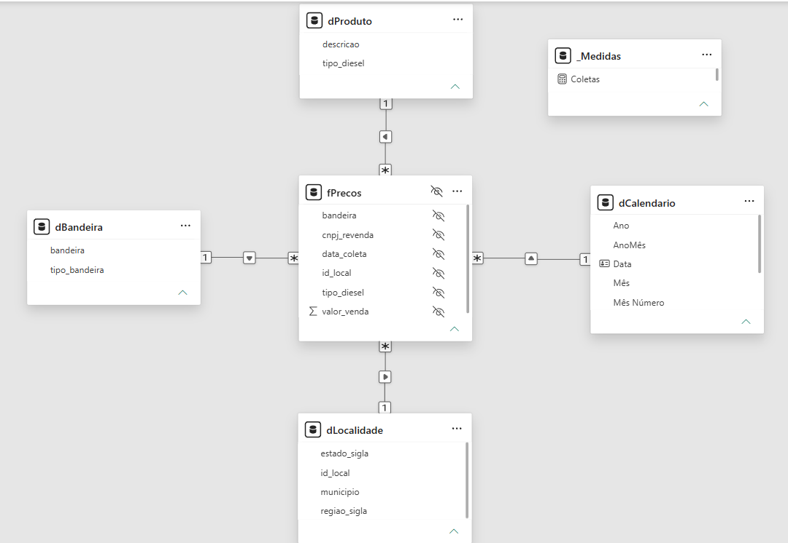

# ⛽ Custo de Combustível de Frota — Onde e quando abastecer diesel mais barato?

> ✅ **Status:** concluído (outubro/2026)

Análise de **231 mil coletas de preço de diesel** feitas pela ANP entre jul/2025 e jun/2026,
do carregamento no **MySQL** ao dashboard interativo no **Power BI**.

**Em resumo:** o diesel S-10 ficou estável até fevereiro de 2026, saltou **15,1% em março**
e terminou o período **16,7% mais caro**. Pernambuco tem o diesel mais barato do país
(**4,1% abaixo da média**) e o Acre, o mais caro (**22,0% acima**).



📷 [Ver o dashboard em alta resolução](imagens/dashboard.png)

---

## 📌 Problema de negócio

Para transportadoras rodoviárias, o diesel é um dos principais custos variáveis
da operação: cada centavo a mais por litro se multiplica pelo volume consumido
por toda a frota ao longo do mês.

Como o preço do diesel varia entre estados, municípios, tipos de posto e ao
longo do tempo, saber **onde e quando abastecer** pode gerar economia relevante
no planejamento de rotas e de paradas.

Este projeto usa dados públicos da ANP para responder: **em que lugar e em que
período o diesel é mais barato no Brasil?**


## ❓ Perguntas de negócio

1. Em quais estados o diesel é mais barato e mais caro?
2. Como o preço variou mês a mês?
3. Existe diferença relevante entre postos de bandeira (marca) e bandeira branca?
4. No estado do Rio de Janeiro, quais municípios têm o menor preço médio?

## 💡 Principais descobertas (diesel S-10, jul/2025 a jun/2026)

> Comparações regionais feitas em relação à média **do mesmo mês**, para
> não distorcer os resultados com a forte alta de março/2026.

1. **Estados:** Pernambuco tem o diesel mais barato do país, **4,1% abaixo da
   média nacional**. O Acre é o mais caro, **22,0% acima** — cerca de 27% mais
   caro que Pernambuco. A região Norte concentra os preços mais altos
   (Acre, Roraima +9,7% e Amazonas +9,2%). O RJ fica na média (+0,4%).

2. **Evolução mensal:** o preço ficou estável entre jul/2025 e fev/2026
   (R$ 6,10 a R$ 6,16), saltou **15,1% em março/2026** e atingiu o pico em
   abril (R$ 7,47). No período completo, a alta foi de **16,7%**. O salto
   coincide com o reajuste da Petrobras de 14/03/2026, anunciado em meio
   à alta internacional do petróleo
   ([fonte](https://eixos.com.br/combustiveis-e-bioenergia/petrobras-anuncia-aumento-de-r-038-sobre-o-diesel-a-nas-refinarias-a-partir-de-sabado/)).

3. **Bandeiras:** postos de marca são mais caros em todos os recortes, mas a
   diferença é pequena: **+1,66% no Brasil** (R$ 0,11/L) e **+0,49% no RJ**.
   Em escala, porém, ela pesa: uma frota hipotética de 20.000 L/mês pagaria
   cerca de **R$ 2.140 a mais por mês** abastecendo só em postos de marca.

4. **Municípios do RJ:** **Belford Roxo (−3,5%)** e **Niterói (−3,4%)**
   estão tecnicamente empatados como os mais baratos do estado, seguidos de
   Três Rios (−3,1%). A capital aparece em 10º (−1,2%).

---

## 📊 O dashboard

| Elemento | O que mostra |
|---|---|
| **Cards de KPI** | Preço médio, variação no período, menor e maior preço, postos pesquisados |
| **Linha mensal** | Evolução do preço médio mês a mês (pergunta 2) |
| **Barras por estado** | Diferença de cada estado para a média nacional do mesmo mês, em verde (abaixo) ou vermelho (acima) (pergunta 1) |
| **Marca vs. bandeira branca** | Preço médio de cada grupo e a diferença percentual (pergunta 3) |
| **Municípios do RJ** | Diferença para a média do estado, com mínimo de 30 coletas (pergunta 4) |
| **Filtros** | Tipo de diesel (seleção única), período, bandeira e região |

Todos os visuais respondem aos filtros e à **filtragem cruzada** (clicar em um estado
filtra o restante do painel). As interações foram ajustadas para que nenhum visual
fique vazio sem motivo — por exemplo, o gráfico do RJ não é afetado pelo clique em
outro estado.

## 🔄 Como foi feito

```
CSV da ANP (806 mil registros, todos os combustíveis)
   │
   ▼  MySQL ─ carga em tabela de staging (tudo como texto) + validação da contagem
   │
   ▼  MySQL ─ limpeza: tipos de dados, filtro do diesel, colunas derivadas (231 mil registros)
   │
   ▼  MySQL ─ consultas das 4 perguntas + testes de robustez
   │
   ▼  Power BI ─ Power Query: consulta base + fato e dimensões por referência
   │
   ▼  Power BI ─ modelo estrela + tabela calendário + medidas DAX validadas contra o SQL
   │
   ▼  Dashboard interativo
```

## 🧩 Modelo de dados



- **Fato:** `fPrecos` — **uma linha por coleta de preço** de um tipo de diesel, em um posto, em uma data
- **Dimensões:** `dCalendario`, `dLocalidade` (chave composta estado + município), `dBandeira` e `dProduto`
- Relacionamentos **1:\*** com direção de filtro **única**

## 🧮 Principais medidas DAX

| Medida | O que calcula |
|---|---|
| `Preço Médio` | Média dos preços de venda coletados |
| `Variação Mensal %` | Variação sobre o mês anterior (`DATEADD`) |
| `Variação no Período %` | Variação entre o primeiro e o último mês com dados nos filtros |
| `Dif. vs Média Nacional %` | Diferença do local para a média nacional **do mesmo mês** |
| `Dif. vs Média do Estado %` | Diferença do município para a média do seu estado no mesmo mês (mín. 30 coletas) |
| `Marca vs Bandeira Branca %` | Diferença de preço entre postos de marca e de bandeira branca |

Todas as medidas foram **conferidas contra os resultados das consultas SQL**.

## 🧪 Decisões de análise

| Decisão | Justificativa |
|---|---|
| S10 e S500 analisados separadamente | São produtos com preços diferentes; misturá-los distorceria as médias |
| Foco no S10 | É o diesel da frota moderna de caminhões |
| Filtro de diesel com seleção única | Impede que o usuário misture os dois tipos no dashboard |
| Coluna "Valor de Compra" descartada | 0 de 231.537 registros de diesel estavam preenchidos |
| Comparações regionais pela média do mesmo mês | Evita que diferenças no período das coletas distorçam os rankings |
| Mínimo de 30 coletas por município | Evita conclusões baseadas em poucas observações |
| Preços de R$ 9,99 em Ourinhos (SP) mantidos | Investigados: 2 postos com preço alto e estável o ano todo (padrão real, não erro). São 15 registros, sem impacto nas médias |
| Carga validada | Os 806.626 registros dos CSVs foram conferidos com contagem no banco |

## ⚠️ Limitações

- Os preços são **coletas de uma pesquisa amostral** da ANP, e não o volume efetivamente vendido. As médias são **simples**, sem ponderação por volume.
- São **preços de bomba**. Transportadoras costumam negociar descontos e contratos com postos e distribuidoras, que não aparecem nos dados.
- O período analisado é de **12 meses** (jul/2025 a jun/2026). Os dados mostram **o quanto** o preço variou, mas não permitem afirmar **por que** variou.

---

## 🗂️ Fonte dos dados

- **Série Histórica de Preços de Combustíveis — ANP**
  (Agência Nacional do Petróleo, Gás Natural e Biocombustíveis)
- Página oficial: https://www.gov.br/anp/pt-br/centrais-de-conteudo/dados-abertos/serie-historica-de-precos-de-combustiveis
- Dicionário de dados (metadados): https://www.gov.br/anp/pt-br/centrais-de-conteudo/dados-abertos/arquivos/shpc/metadados-serie-historica-precos-combustiveis-1.pdf
- Período analisado: 2º semestre de 2025 e 1º semestre de 2026
- Produto analisado: óleo diesel (S-10 e S-500)

### Visão geral dos arquivos brutos

| Arquivo | Registros | Colunas | Separador |
|---|---|---|---|
| `ca-2025-02.csv` | 384.208 | 16 | `;` |
| `ca-2026-01.csv` | 422.418 | 16 | `;` |
| **Total** | **806.626** | | |

## 🛠️ Ferramentas

| Etapa | Ferramenta |
|---|---|
| Armazenamento, limpeza e consultas | MySQL 8.4 (via Laragon) |
| Modelagem | Power BI — Power Query |
| Medidas e visualização | Power BI — DAX |
| Versionamento | Git e GitHub |

## 📁 Estrutura do repositório

| Caminho | Conteúdo |
|---|---|
| `dados/brutos/` | CSVs e metadados da ANP (não versionados — ver "Como reproduzir") |
| `sql/01_setup.sql` | Criação do banco e do usuário com acesso restrito |
| `sql/02_staging_carga.sql` | Carga dos CSVs na tabela de staging e validação |
| `sql/03_limpeza.sql` | Tabela final do diesel, com tipos convertidos |
| `sql/04_consultas.sql` | Respostas às 4 perguntas e testes de robustez |
| `powerbi/custo-diesel-frota.pbix` | Dashboard e modelo de dados |
| `powerbi/tema-diesel.json` | Tema visual do relatório |
| `imagens/` | Print, GIF e modelo de dados |

## ▶️ Como reproduzir

**1. Dados**
- Baixe os arquivos do **2º semestre de 2025** e do **1º semestre de 2026**
  (Combustíveis automotivos) na página oficial da ANP, acima.
- Extraia os CSVs em `dados/brutos/` e renomeie para `ca-2025-02.csv` e `ca-2026-01.csv`.

**2. MySQL**
- Execute `sql/01_setup.sql` como **root** (troque `SUA_SENHA_AQUI` pela senha desejada).
- No `sql/02_staging_carga.sql`, ajuste o **caminho dos CSVs** para a pasta do seu computador.
- Conecte com `mysql --local-infile=1 -u analista_diesel -p diesel_anp` e execute, nesta ordem:
  `02_staging_carga.sql`, `03_limpeza.sql` e `04_consultas.sql`.

**3. Power BI**
- Abra `powerbi/custo-diesel-frota.pbix` no Power BI Desktop.
- Em **Transformar dados → Configurações da fonte de dados**, informe o usuário
  `analista_diesel` e a sua senha para a fonte `localhost;diesel_anp`.
- Clique em **Atualizar**.

## 🚀 Melhorias futuras

- Incluir os meses mais recentes, já disponíveis nos arquivos mensais da ANP
- Publicar o dashboard no Power BI Service para acesso pelo navegador
- Estimar o custo de uma rota real, cruzando os preços com os municípios do trajeto

---

## 👩‍💻 Autora

**Alice Eduarda** — Estudante de Análise e Desenvolvimento de Sistemas (UNISUAM)
[LinkedIn](https://www.linkedin.com/in/aliceeduarda-mth) · [GitHub](https://github.com/aliceeduarda)